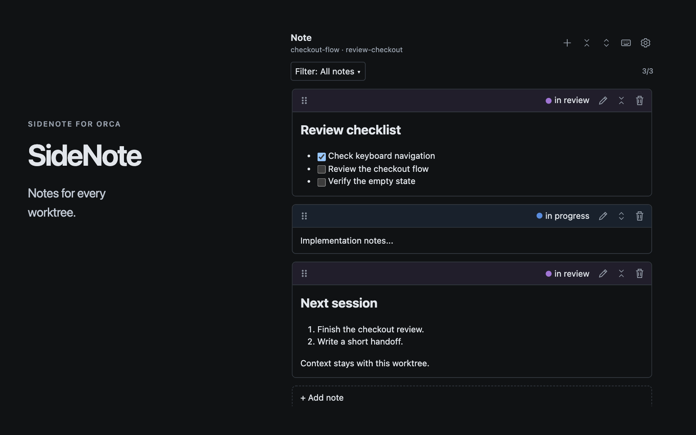

# SideNote for Orca

Keep Markdown notes beside each local Orca project or worktree. SideNote follows the focused location and saves edits automatically. Paired remote worktrees are not supported.

*The compiled SideNote panel with demo data, captured in an isolated browser host with in-memory storage.*

## Keep each project's notes together

- Keep a separate, ordered note collection for each host and folder path. Switching worktrees brings back that location's notes.
- Mix editing and reading cards. Minimize notes you want to keep nearby, and reorder cards as your work changes.
- Edit Markdown with find and replace, line numbers, and per-note undo. Toggle task checkboxes in reading mode.
- Organize notes with shared, customizable labels and filter each location's collection by label.
- Back up and restore note collections with a JSON file.

Reading mode displays code blocks as plain text. It does not render diagrams or load images. See [Usage](docs/USAGE.md) for editing and links, [Labels](docs/LABELS.md) for classification, and [Filtering](docs/FILTERING.md) for choosing which notes to display.

## Try a local checkout

The development setup uses macOS, Orca and its CLI, Node.js 22 or later, and npm. Load only a trusted checkout. Its `trusted-worker` runs code with your account permissions.

1. [Build the checkout](docs/DEVELOPMENT.md#prerequisites-and-setup).
2. [Load the development folder](docs/DEVELOPMENT.md#load-the-development-folder).
3. Open **Note** in Orca's right sidebar.

Notes live in Orca's plugin storage, not project files or Git. They do not sync or back up automatically. [Back up important notes](docs/DATA.md#back-up-notes) to a separate file.

For changes, see [Contributing](CONTRIBUTING.md). For operational help, see [Maintenance](docs/MAINTENANCE.md).

## License

Project code is available under the [MIT License](LICENSE). Third-party files retain their own licenses. See [third-party notices](docs/NOTICES.md).
