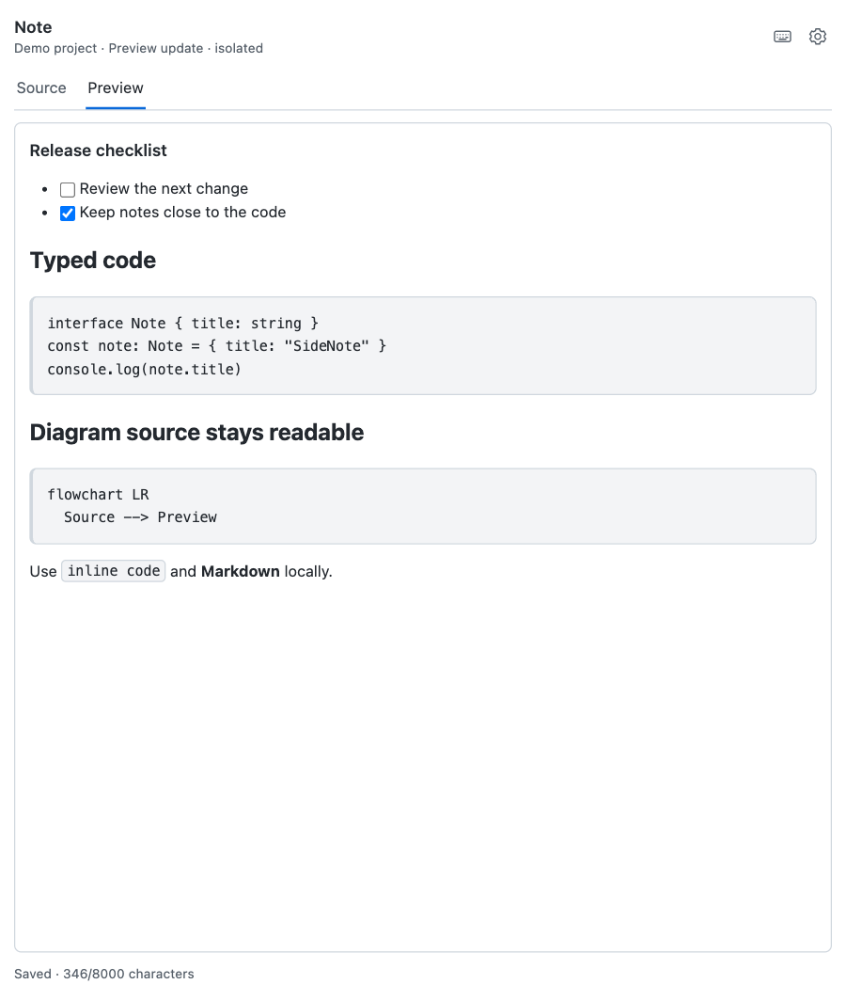

# SideNote for Orca

Keep a Markdown note beside each Orca project or worktree. SideNote follows the focused location and saves edits automatically.

*Preview of a synthetic demo note in the compiled panel, captured with an isolated browser host.*

## In this checkout

- Keep separate notes for each host and folder path, including worktrees.
- Write in Source with find and replace, line numbers, and per-note undo.
- Read formatted Markdown in Preview, toggle tasks, and view plain-text code blocks.
- Back up and restore notes with a JSON file.

Preview does not render diagrams or load images. See [Usage](docs/USAGE.md) for editing and [Data](docs/DATA.md) for backup and restore.

## Try a local checkout

The development setup uses macOS, Orca and its CLI, Node.js 20 or later, and npm. Load only a trusted checkout. Its `trusted-worker` runs code with your account permissions.

1. [Build the checkout](docs/DEVELOPMENT.md#prerequisites-and-setup).
2. [Load the development folder](docs/DEVELOPMENT.md#load-the-development-folder).
3. Open **Note** in Orca's right sidebar.

Notes live in Orca's plugin storage, not project files or Git. They do not sync or back up automatically. [Back up important notes](docs/DATA.md#back-up-notes) to a separate file.

For changes, see [Contributing](CONTRIBUTING.md). For operational help, see [Maintenance](docs/MAINTENANCE.md).

## License

Project code is available under the [MIT License](LICENSE). Third-party files retain their own licenses. See [third-party notices](docs/NOTICES.md).
